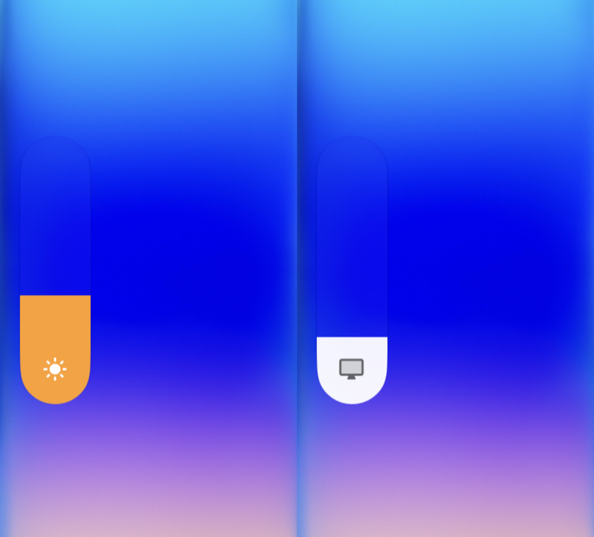

# DisBright – External Monitor Brightness & Volume Control for macOS

Control brightness and volume of external monitors right from the macOS menu bar, including the keyboard brightness and volume keys. A free alternative to BetterDisplay, MonitorControl and Lunar.

**Download:** [latest release](../../releases/latest) → unzip, move DisBright to Applications. On first launch right-click → Open (the app is not notarized).

**Build:** macOS 13+, Xcode Command Line Tools → `./build_app.sh`

Feedback and ideas are welcome – just open an [issue](../../issues).

MIT License © sami_i04

---
betterdisplay alternative, monitorcontrol alternative, lunar alternative, external monitor brightness, external monitor volume, ddc brightness, menu bar app, display control, swift, macos
